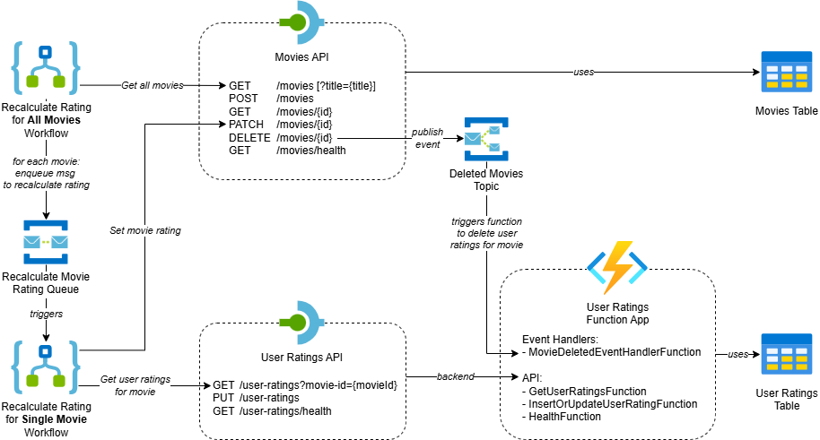
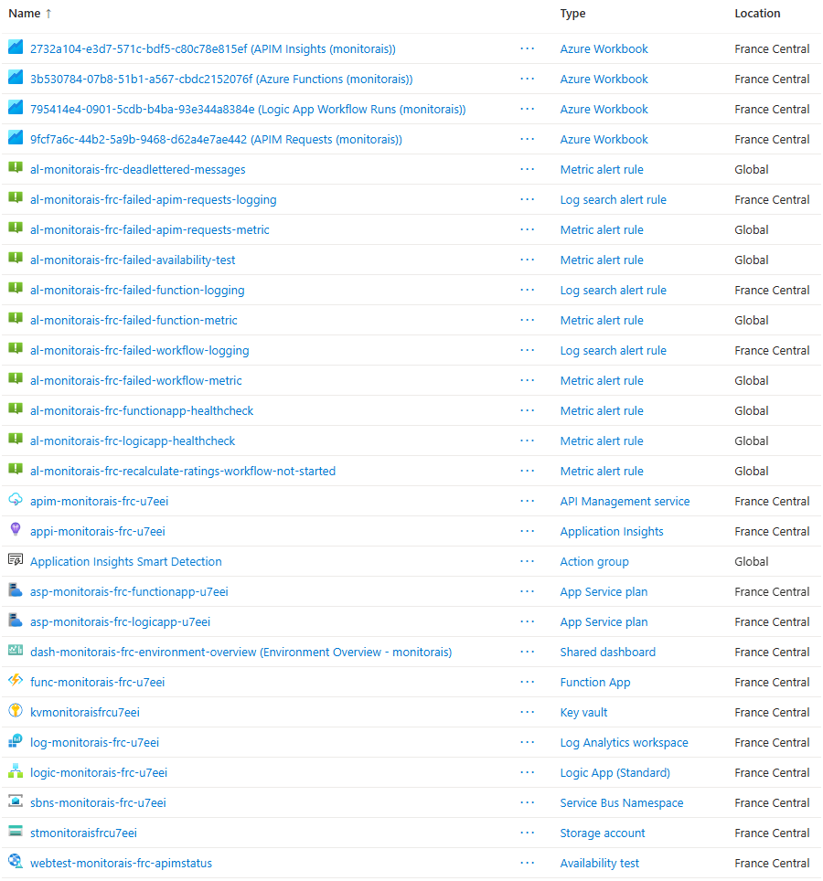

# Monitor Azure Integration Services - Demo

This demo introduces an Azure application that demonstrates ways to monitor Azure Integration Services, including dashboards, workbooks, alerts and health checks.

See the following diagram for an overview of the application:



See the repository [README](../README.md) for a detailed description of the application.

## 1. What resources are getting deployed

The following resources will be deployed:



## 2. What can I demo from this scenario after deployment

### Scenarios

The following scenarios are available. Each scenario has its own demo guide with instructions. The shared testing instructions can be used with all scenarios.

- [Environment Overview Dashboard](./demo-environment-overview-dashboard.md)

### Shared testing instructions

The application can be explored manually using the REST Client extension in Visual Studio Code, or automatically using the .NET integration tests. The setup below applies to all scenarios.

#### Manual testing using Visual Studio Code

The repository includes [`tests.http`](../tests/tests.http), which contains requests for the Movies and User Ratings APIs.

To send requests using the [REST Client](https://marketplace.visualstudio.com/items?itemName=humao.rest-client) extension:

1. Install the REST Client extension in Visual Studio Code.
1. Locate the **Manual Tester Subscription** in API Management and copy its primary key.
1. Open the Command Palette (`Ctrl+Shift+P`) and choose `Preferences: Open User Settings (JSON)`.
1. Add an environment to your user settings with the API Management hostname and subscription key. Replace the example key with your own:

   ```json
   "rest-client.environmentVariables": {
       "monitorais": {
           "apimHostname": "apim-monitorais-frc-u7eei.azure-api.net",
           "apimSubscriptionKey": "1234567890abcdefghijklmnopqrstuv"
       }
   }
   ```

1. Open [`tests.http`](../tests/tests.http), then select the `monitorais` environment from the environment selector in the bottom-right corner of the editor.
1. Click **Send Request** above a request to execute it.

The requests are ordered to walk through the APIs: check the health endpoints, list and filter movies, create a movie, retrieve its details and ratings, add a user rating, update the movie and delete it. The create request generates a movie ID that is used by the following requests. A static movie ID is also provided as an alternative. The Logic App recalculates ratings periodically, so rating changes based on user ratings may not appear immediately.

#### Automated integration tests

The repository includes .NET 10 integration tests in [tests/IntegrationTests](../tests/IntegrationTests). The tests use your local `azd` environment variables from `.azure/<environment-name>/.env` to connect to the deployed resources. Make sure the `azd` environment is set to the correct deployment before running the tests.

To run the integration tests from the command line, navigate to the `tests/IntegrationTests` folder and run:

```powershell
dotnet run
```

### Demo scripts

The [scripts](../scripts) folder contains PowerShell scripts for creating and recovering demo scenarios. 
Run them from the repository root with Azure CLI and Azure Developer CLI installed and authenticated, and with the correct `azd` environment selected. 
The scripts use that environment's variables by default. 
Your account also needs the Azure permissions described in each script.

#### Break or restore Movies API health

The [toggle-movies-api-health.ps1](../scripts/toggle-movies-api-health.ps1) script breaks or restores the Movies API's connection to Table Storage, affecting Movies API requests and dependent Logic App health checks. It prompts for confirmation; use `azd exec --interactive` to allow input.

```powershell
azd exec --interactive ./scripts/toggle-movies-api-health.ps1
```

#### Break or restore Function App health

The [toggle-function-app-health.ps1](../scripts/toggle-function-app-health.ps1) script breaks or restores the Function App's connection to Table Storage, affecting Function App and User Ratings API requests and dependent Logic App health checks. Updating the setting restarts the Function App, so it might take a moment before the health actually changes. It prompts for confirmation; use `azd exec --interactive` to allow input.

```powershell
azd exec --interactive ./scripts/toggle-function-app-health.ps1
```

#### Publish an invalid movie-deleted event

The [publish-invalid-movie-deleted-event.ps1](../scripts/publish-invalid-movie-deleted-event.ps1) script publishes an invalid event to the `deleted-movies` Service Bus topic, causing the [MovieDeletedEventHandlerFunction](../src/functionApp/FunctionApp/EventHandlers/MovieDeletedEventHandlerFunction.cs) to fail and the message to be dead-lettered. It requires the **Azure Service Bus Data Sender** role on the namespace.

```powershell
azd exec ./scripts/publish-invalid-movie-deleted-event.ps1
```

#### Publish an invalid recalculate-movie-rating message

The [publish-invalid-recalculate-movie-rating-message.ps1](../scripts/publish-invalid-recalculate-movie-rating-message.ps1) script publishes an invalid message to the `recalculate-movie-rating` Service Bus queue, causing a failed Recalculate Rating for Single Movie workflow run. It requires the **Azure Service Bus Data Sender** role on the namespace.

```powershell
azd exec ./scripts/publish-invalid-recalculate-movie-rating-message.ps1
```

#### Purge dead-lettered movie-deleted events

The [purge-dead-lettered-movie-deleted-events.ps1](../scripts/purge-dead-lettered-movie-deleted-events.ps1) script deletes all messages in the dead-letter queue of the `function-app` subscription on the `deleted-movies` topic. This operation cannot be undone. It requires the **Azure Service Bus Data Receiver** role on the namespace.

```powershell
azd exec ./scripts/purge-dead-lettered-movie-deleted-events.ps1
```

#### Delete all movies and related user ratings

The [delete-all-movies.ps1](../scripts/delete-all-movies.ps1) script deletes all movies using the Movies API. The integration application then removes all related user ratings, clearing the storage tables. This operation cannot be undone. It reads the subscription key from the `tester-apim-subscription-key` secret in Key Vault, so it requires the **Key Vault Secrets User** role on the Key Vault. It prompts for confirmation; use `azd exec --interactive` to allow input.

```powershell
azd exec --interactive ./scripts/delete-all-movies.ps1
```

#### Start or stop the Function App

The [toggle-function-app-state.ps1](../scripts/toggle-function-app-state.ps1) script starts a stopped Function App or stops a running one. It prompts for confirmation; use `azd exec --interactive` to allow input.

```powershell
azd exec --interactive ./scripts/toggle-function-app-state.ps1
```

#### Start or stop the Logic App

The [toggle-logic-app-state.ps1](../scripts/toggle-logic-app-state.ps1) script starts a stopped Logic App or stops a running one. It prompts for confirmation; use `azd exec --interactive` to allow input.

```powershell
azd exec --interactive ./scripts/toggle-logic-app-state.ps1
```
