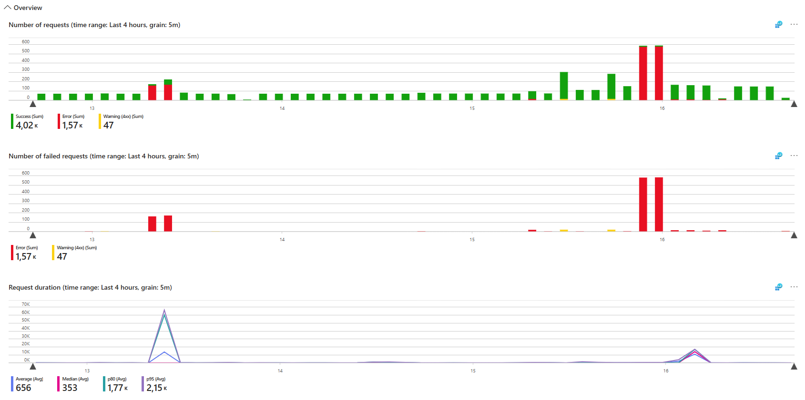
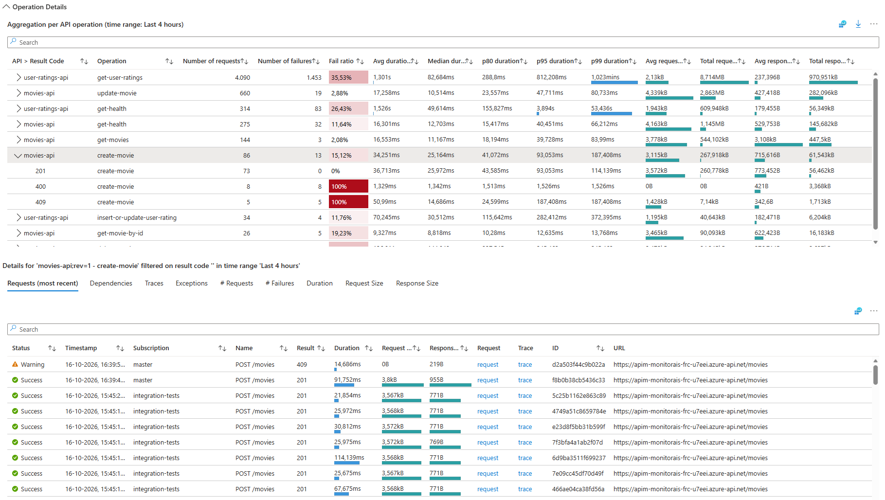

# APIM Insights Workbook

The APIM Insights workbook helps investigate API Management capacity, request volume, failures, and performance, from an overview of API activity to the requests, dependencies, traces, and exceptions for a selected API operation.

The workbook is deployed with the monitoring resources from [APIM Insights.workbook](../infra/03-monitoring/modules/workbooks/APIM%20Insights.workbook).

To use this workbook without deploying the entire template, follow the [manual deployment instructions](#manually-deploy-the-workbook).

## Open the workbook

After deploying the template, open the resource group for your `azd` environment in the Azure portal and open the **APIM Insights** workbook. Set the time range to include the activity you want to inspect. Workflow telemetry can take a few minutes to appear.

The **Capacity and Scaling (v1 tier)**, **Capacity and Scaling (v2 tier)**, **Overview**, and **Operation Details** groups are collapsed by default. Expand a group by clicking its heading.

All graphs support **time brushing**: drag across a time interval in any graph to update the **Time** parameter. All graphs and tables in the workbook then update to reflect the selected time range.

Use the [shared testing instructions](./README.md#shared-testing-instructions) to generate traffic through the Movies and User Ratings APIs, then refresh the workbook.

## 1. Capacity and Scaling (v1 tier)

The **API Management Capacity** metric is available only for certain v1 tiers, so this graph may not show data for every v1 tier.

1. Review **API Management Capacity** to see how gateway capacity changes over time.
1. If your API Management service has an autoscale setting, select it in **API Management Autoscaling**. The optional **API Management Autoscale** graph shows the observed capacity (instance count) over time.
1. Compare capacity and scaling changes with request volume and duration in the **Overview** section.

<!-- Add the Capacity and Scaling screenshot here when available. -->

## 2. Capacity and Scaling (v2 tier)

The graphs in the **Capacity and Scaling (v2 tier)** group show CPU and memory utilization over time for v2 tiers.

1. Review **API Management CPU** and **API Management Memory** to see how gateway resource utilization changes over time.
1. If your API Management service has an autoscale setting, select it in **API Management Autoscaling**. The optional **API Management Autoscale** graph shows the observed capacity (number of units) over time.
1. Compare CPU, Memory and scaling changes with request volume and duration in the **Overview** section.

## 3. Overview

1. Use **Subscription** to filter by API Management subscription and **API** to narrow the results to specific APIs. Leave these filters empty to include all values.
1. Review **Number of requests** to compare successful requests (green), errors (red), and warnings for unsuccessful requests with HTTP 4xx result codes (yellow).
1. Review **Number of failed requests** to focus on errors and warnings without successful traffic.
1. Compare **Request duration** across average, median, p80, and p95 to identify latency spikes.

## 4. Operation Details

1. Use **Subscription** to filter by API Management subscription and **API** to narrow the results to specific APIs. Leave these filters empty to include all values.
1. Review **Aggregation per API operation** to compare request counts, failure counts and ratios, duration percentiles, and request and response sizes.
1. Sort by **Number of failures**, **Fail ratio**, or a duration column to find operations worth investigating.
1. Expand an operation to see its HTTP result codes. Select the operation row to inspect all its requests, or select a result-code row to filter the details to that result code.
1. In **Requests (most recent)**, inspect individual requests, including their subscription, result, duration, sizes, and URL. Use **request** to open request details or **trace** to investigate the end-to-end transaction in Application Insights.
1. Switch to **Dependencies**, **Traces**, or **Exceptions** to inspect related telemetry for the selected operation and result code. These tabs may be empty if no corresponding telemetry was recorded.
1. Use **# Requests**, **# Failures**, **Duration**, **Request Size**, and **Response Size** to review trends for the selection.

## Demonstrate failed requests

1. Use the [Break or restore Movies API health script](./README.md#break-or-restore-movies-api-health) to break the Movies API's connection to Table Storage.
1. Send a Movies API health request using the [manual testing instructions](./README.md#manual-testing-using-visual-studio-code).
1. Refresh the workbook once telemetry has arrived. Filter **API** to **movies-api** and inspect the failed requests in **Overview**.
1. In **Operation Details**, expand **get-health** and select the failing result code. Inspect the request and its related telemetry to investigate the storage connection failure.
1. Run the same script to restore the connection, send another health request, and refresh the workbook to confirm successful requests appear again.

## Manually deploy the workbook

You can deploy the workbook independently of this template if you want to use it in your own environment.

1. Navigate to your **Application Insights** resource in the **Azure portal**.
1. Open **Workbooks**.
1. Click **+ New**.
1. Click the **`</>`** button to open the advanced editor.
1. Ensure the **Gallery Template** tab is selected.
1. Paste the contents of [APIM Insights.workbook](../infra/03-monitoring/modules/workbooks/APIM%20Insights.workbook) into the editor.
1. Click **Apply**.
1. Configure **Azure Subscription**, **Application Insights**, and **API Management**. Optionally select an **API Management Autoscaling** resource.
1. Click **Save**.
1. Specify a **Title** and configure the **Subscription**, **Resource Group**, and **Location** where you want to save the workbook.
1. Click **Save As**.

Ensure API Management is configured to send request telemetry to the selected Application Insights resource. The template configures this through an Application Insights logger and diagnostics settings in [api-management.bicep](../infra/01-base/modules/api-management.bicep).
