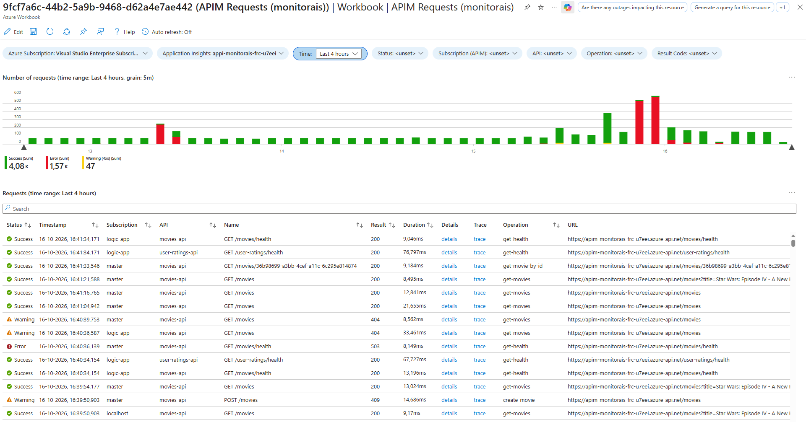

# APIM Requests Workbook

The APIM Requests workbook helps investigate individual API Management requests, from request volume over time to the details and traces for a selected request.

The workbook is deployed with the monitoring resources from [APIM Requests.workbook](../infra/03-monitoring/modules/workbooks/APIM%20Requests.workbook).

To use this workbook without deploying the entire template, follow the [manual deployment instructions](#manually-deploy-the-workbook).

## Open the workbook

After deploying the template, open the resource group for your `azd` environment in the Azure portal and open the **APIM Requests** workbook. Set the time range to include the activity you want to inspect. Request telemetry can take a few minutes to appear.

Use the [shared testing instructions](./README.md#shared-testing-instructions) to generate traffic through the Movies and User Ratings APIs, then refresh the workbook.

## Explore API requests

1. Set **Time** to cover the requests you want to investigate.
1. Use **Status**, **Subscription (APIM)**, **API**, **Operation**, and **Result Code** to narrow the results. Leave a filter unselected to include all its values.
1. Review **Number of requests** to compare successful requests (green), warnings for HTTP 4xx result codes (yellow), and errors (red). Drag across a time interval in the chart to update **Time** and refresh the workbook for that interval.
1. In **Requests**, inspect the status, timestamp, subscription, API, operation, result code, duration, and URL for each request. Use the table search and column sorting to find a specific request.
1. Select **details** to open the request details in a context pane, or **trace** to investigate the end-to-end transaction details of the request in Application Insights.

## Demonstrate failed requests

1. Use the [Break or restore Movies API health script](./README.md#break-or-restore-movies-api-health) to break the Movies API's connection to Table Storage.
1. Send a Movies API health request using the [manual testing instructions](./README.md#manual-testing-using-visual-studio-code).
1. Refresh the workbook once telemetry has arrived. Filter **Status** to **Error**, **API** to **movies-api**, and **Operation** to **get-health**. The failed health request should appear with an HTTP 5xx result code.
1. Select **details** or **trace** on the request to investigate its telemetry in Application Insights.
1. Run the same script to restore the connection, send another health request, and refresh the workbook to confirm the successful request appears.

## Manually deploy the workbook

You can deploy the workbook independently of this template if you want to use it in your own environment.

1. Navigate to your **Application Insights** resource in the **Azure portal**.
1. Open **Workbooks**.
1. Click **+ New**.
1. Click the **`</>`** button to open the advanced editor.
1. Ensure the **Gallery Template** tab is selected.
1. Paste the contents of [APIM Requests.workbook](../infra/03-monitoring/modules/workbooks/APIM%20Requests.workbook) into the editor.
1. Click **Apply**.
1. Configure **Azure Subscription** and **Application Insights** parameters.
1. Click **Save**.
1. Specify a **Title** and configure the **Subscription**, **Resource Group**, and **Location** where you want to save the workbook.
1. Click **Save As**.

Ensure API Management is configured to send request telemetry to the selected Application Insights resource. The template configures this through an Application Insights logger and diagnostics settings in [api-management.bicep](../infra/01-base/modules/api-management.bicep).
