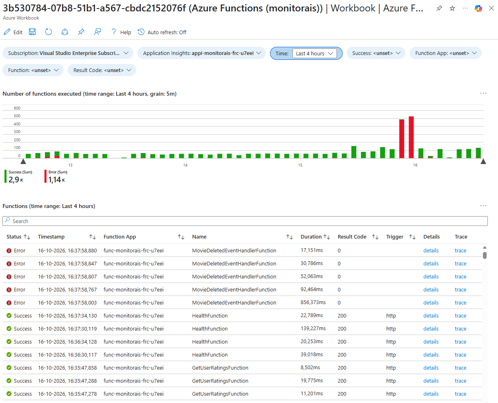

# Azure Functions Workbook

The Azure Functions workbook helps investigate function executions, from request volume over time to the details and traces for an individual function.

The workbook is deployed with the monitoring resources from [Azure Functions.workbook](../infra/03-monitoring/modules/workbooks/Azure%20Functions.workbook).

To use this workbook without deploying the entire template, follow the [manual deployment instructions](#manually-deploy-the-workbook).

## Open the workbook

After deploying the template, open the resource group for your `azd` environment in the Azure portal and open the **Azure Functions** workbook. Set the time range to include the activity you want to inspect. Function telemetry can take a few minutes to appear.

Use the [shared testing instructions](./README.md#shared-testing-instructions) to generate function activity, then refresh the workbook.

## Explore function executions

1. Review **Number of functions executed** to compare successful executions (green) and errors (red). Drag across a time interval in the chart to update **Time** and refresh the workbook for that interval.
1. Use **Success**, **Function App**, **Function**, and **Result Code** to narrow the results. Leave a filter unselected to include all its values.
1. In **Functions**, inspect the status, timestamp, Function App, function name, duration, result code, and trigger for each execution. Use the table search and column sorting to find an execution.
1. Select **details** to open the request details in a context pane, or **trace** to investigate the end-to-end transaction in Application Insights.

## Demonstrate a failed function

1. Use the [Publish an invalid movie-deleted event script](./README.md#publish-an-invalid-movie-deleted-event) to send an invalid event to the `deleted-movies` Service Bus topic. The `MovieDeletedEventHandlerFunction` will fail while processing it, and the message will be dead-lettered.
1. Refresh the workbook once telemetry has arrived. Set **Success** to **no** and **Function** to **MovieDeletedEventHandlerFunction** to find the failed execution.
1. Select **details** or **trace** to inspect the execution in Application Insights.
1. To clean up the dead-lettered message, use the [Purge dead-lettered movie-deleted events script](./README.md#purge-dead-lettered-movie-deleted-events).

## Manually deploy the workbook

You can deploy the workbook independently of this template if you want to use it in your own environment.

1. Navigate to your **Application Insights** resource in the **Azure portal**.
1. Open **Workbooks**.
1. Click **+ New**.
1. Click the **`</>`** button to open the advanced editor.
1. Ensure the **Gallery Template** tab is selected.
1. Paste the contents of [Azure Functions.workbook](../infra/03-monitoring/modules/workbooks/Azure%20Functions.workbook) into the editor.
1. Click **Apply**.
1. Configure **Azure Subscription** and **Application Insights** parameters.
1. Click **Save**.
1. Specify a **Title** and configure the **Subscription**, **Resource Group**, and **Location** where you want to save the workbook.
1. Click **Save As**.

Ensure Azure Functions is configured to send request telemetry to the selected Application Insights resource.
