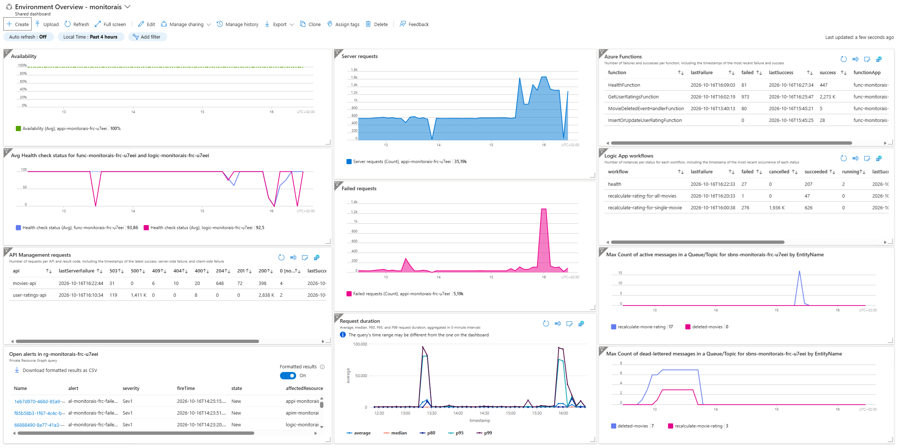

# Environment Overview Dashboard

The Environment Overview dashboard brings the main health and activity signals for the deployed environment together in the Azure portal.

## Open the dashboard

After deploying the template, open [Dashboards](https://portal.azure.com/#dashboard) in the Azure portal and select **Environment Overview - _your-environment-name_** for your `azd` environment. The dashboard is deployed to the environment's resource group.

Set the dashboard's time range to include the activity you want to review. You can also enable auto refresh or refresh the dashboard after generating traffic. Telemetry can take a few minutes to appear.

## Explore the dashboard

The dashboard provides a high-level view of the environment:

- **Availability** and **Avg Health check status** show availability test results and the health reported by the Function App and Logic App.
- **API Management requests** shows request results by API.
- **Open alerts** lists active Azure Monitor alerts in the environment's resource group.
- **Server requests**, **Failed requests**, and **Request duration** show request volume, failures, and latency.
- **Azure Functions** and **Logic App workflows** summarize function executions and workflow runs, including failures.
- **Active messages** and **dead-lettered messages** show Service Bus queue and topic activity.

Some charts and tables may be empty until the corresponding resource has received traffic or generated telemetry.

## Generate activity

Use the [shared testing instructions](./README.md#shared-testing-instructions) to generate traffic to the various Azure Integration Services.

To demonstrate failures and alerts, follow the relevant [demo scripts](./README.md#demo-scripts). For example, you can break and restore API or Function App health, publish invalid Service Bus messages, or stop and start the Function App or Logic App. Refresh the dashboard and adjust its time range to see the resulting telemetry. Restore any changed health or resource state when you are done.
