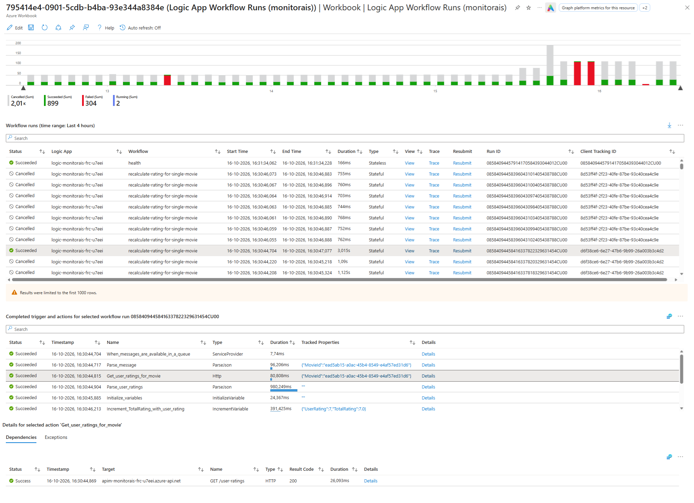

# Logic App Workflow Runs Workbook

The Logic App Workflow Runs workbook helps investigate Logic App workflow runs, from an overview of run activity to the triggers, actions, dependencies, and exceptions for a selected run.



The workbook is deployed with the monitoring resources from [Logic App Workflow Runs.workbook](../infra/03-monitoring/modules/workbooks/Logic%20App%20Workflow%20Runs.workbook).

To use this workbook without deploying the entire template, follow the [manual deployment instructions](#manually-deploy-the-workbook).

## Open the workbook

After deploying the template, open the resource group for your `azd` environment in the Azure portal and open the **Logic App Workflow Runs** workbook. Set the time range to include the activity you want to inspect. Workflow telemetry can take a few minutes to appear.

## Explore workflow runs

1. Review the chart to compare run counts by status over time.
1. Use the **Status**, **Logic App**, and **Workflow** filters to narrow the results. Enter a **Client Tracking ID** to find runs associated with a specific request.
1. Select a run in the table to see its completed triggers and actions. 
1. Use **View** to view the workflow in the designer.  
   This will only work for stateful workflows, or stateless workflows with run history enabled by setting the app setting `Workflows.<workflow-name>.OperationOptions` to `WithStatelessRunHistory`.
1. Use **Trace** to inspect the run in Application Insights.
1. For a stateful workflow, use **Resubmit** to open a context pane where you can start a new run with the same trigger data.
1. Select an action to inspect its dependencies or exceptions. The **Details** link opens the corresponding details.

## Demonstrate a failed run

To create a failed workflow run, use the [Publish an invalid recalculate-movie-rating message script](./README.md#publish-an-invalid-recalculate-movie-rating-message). Then refresh the workbook and filter **Status** to **Failed**. Select the failed run to follow its trigger and actions and inspect the failure details.

## Manually deploy the workbook

You can deploy the workbook independently of this template if you want to use it in your own environment.

1. Navigate to your **Application Insights** resource in the **Azure portal**.
1. Open **Workbooks**.
1. Click **+ New**.
1. Click the **`</>`** button to open the advanced editor.
1. Ensure the **Gallery Template** tab is selected.
1. Paste the contents of [Logic App Workflow Runs.workbook](../infra/03-monitoring/modules/workbooks/Logic%20App%20Workflow%20Runs.workbook) into the editor.
1. Click **Apply**.
1. Configure **Subscription** and **Application Insights** parameters.
1. Click **Save**.
1. Specify a **Title** and configure the **Subscription**, **Resource Group**, and **Location** where you want to save the workbook.
1. Click **Save As**.

Ensure you have enabled enhanced telemetry for your Logic App by configuring the `Runtime.ApplicationInsightTelemetryVersion` setting to `v2` in your host.json file. For example:

```json
{
   "version": "2.0",
   "extensionBundle": {
      "id": "Microsoft.Azure.Functions.ExtensionBundle.Workflows",
      "version": "[1, 2.00]"
   },
   "extensions": {
      "workflow": {
         "Settings": {
            "Runtime.ApplicationInsightTelemetryVersion": "v2"
         }
      }
   }
}
```
